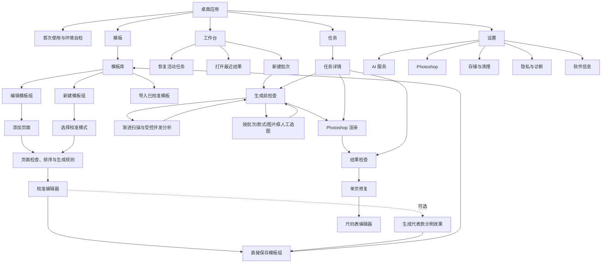
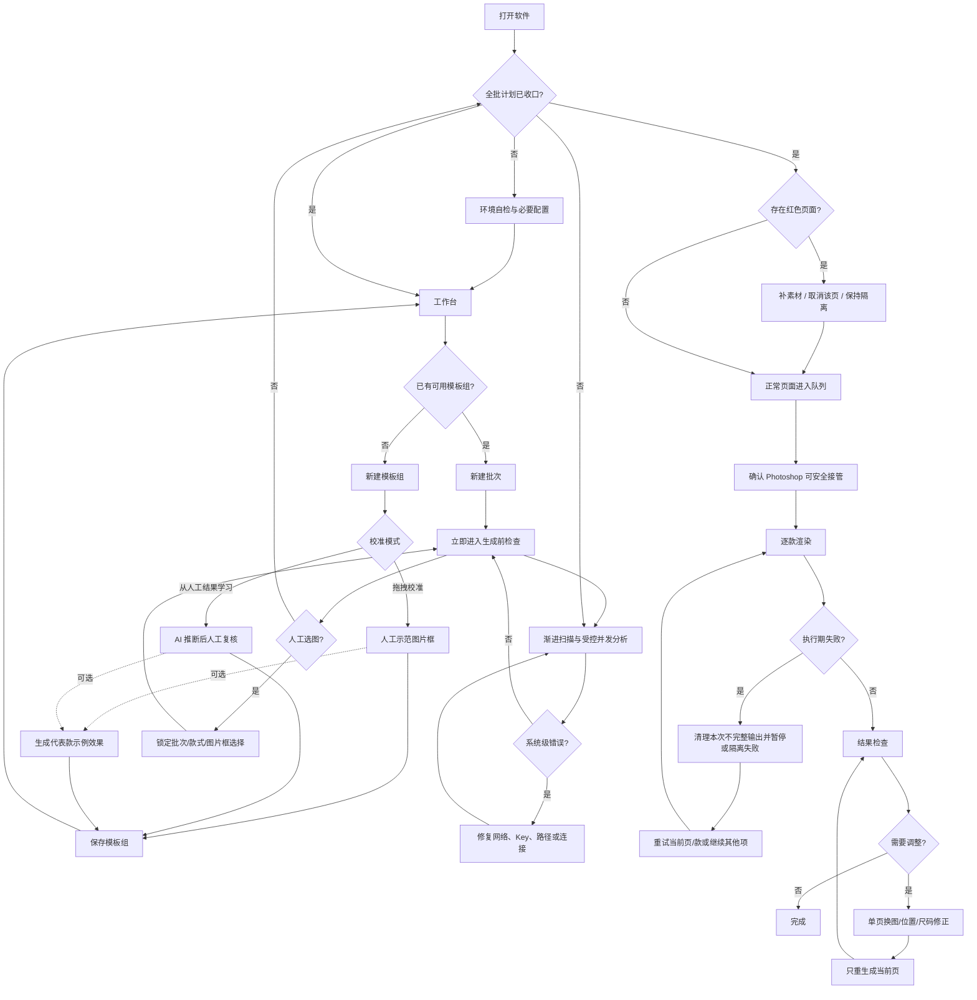

# 桌面端页面信息架构与交互规格

## 文档信息

| 项目 | 内容 |
| --- | --- |
| 版本 | 1.1 |
| 状态 | 低保真已确认 |
| 日期 | 2026-08-25 |
| 唯一需求输入 | `产品需求文档-电商详情页智能生产系统-PRD-1.4.md` |
| 当前任务 | `docs/任务/页面信息架构与交互设计.md` |

本文件定义经产品负责人确认的 V1 页面结构、交互路径、页面状态和关键确认文案，不改变 PRD 1.4 的功能范围。视觉颜色、字体、间距和品牌样式在高保真阶段另行设计。v1.1 在 v1.0 基础上补齐已校准模板组增量添加页面和批次模板快照交互，并完整替代 v1.0。

## 1. 设计目标

- 日常批次保持最短主路径：选择模板、选择批次目录、选择输出目录、分析、生成、检查结果。
- 模板校准虽然低频，但必须让不懂脚本的美工可以独立完成。
- 只在需要用户判断时打断；绿色和黄色页面默认继续，红色页面按页隔离。
- Photoshop 状态始终可见，但不把 Photoshop 技术细节放进日常业务界面。
- 所有删除、清理和迁移操作明确说明不会触碰什么，避免用户担心原始文件和正式输出。
- 长任务离开当前页面后继续运行，用户返回时能从相同状态继续。

## 2. 全局结构

### 2.1 主导航

V1 只设四个一级入口：

1. **工作台**：开始新批次、恢复进行中任务、查看最近结果。
2. **模板**：管理模板组以及进入新建、校准、编辑、导入和导出流程。
3. **任务**：查看全部批次、状态、历史结果和恢复入口。
4. **设置**：AI 服务、Photoshop、存储与清理、隐私与诊断、软件信息。

以下内容不设一级入口：AI 分析、尺码表、结果页和数据管理。它们分别属于任务流程、单页修复和设置，独立放入主导航会增加理解成本。

### 2.2 应用外壳

```text
┌─────────────────────────────────────────────────────────────────────┐
│ 应用名称                         Photoshop 已连接 · 无渲染任务      │
├────────────┬────────────────────────────────────────────────────────┤
│ 工作台     │ 页面标题 / 面包屑                         主要操作    │
│ 模板       ├────────────────────────────────────────────────────────┤
│ 任务       │                                                        │
│            │                    当前页面内容                        │
│            │                                                        │
│ 设置       │                                                        │
├────────────┴────────────────────────────────────────────────────────┤
│ 仅在有活动任务时显示：任务名 · 当前阶段 · 进度 · 查看任务          │
└─────────────────────────────────────────────────────────────────────┘
```

- 左侧导航固定，不放账户、商家工作区或云同步入口。
- 顶部右侧只显示 Photoshop 连接和渲染占用状态；API 异常在相关操作处显示。
- 底部活动任务条仅在扫描、分析、等待生成、渲染、暂停或失败待处理时出现。
- 页面内只保留一个高优先级主要操作；次要操作使用普通按钮或菜单。
- 全局消息只用于保存成功、路径复制等短反馈；必须处理的问题留在页面内，不依赖自动消失提示。

### 2.3 信息架构



## 3. 页面清单

| ID | 页面 | 主要入口 | 页面目标 | 主要操作 | 离开条件 |
| --- | --- | --- | --- | --- | --- |
| F-01 | 首次使用与环境自检 | 首次启动 | 配置运行必需条件 | 完成配置 | Photoshop、存储、Key 和授权通过基本检查 |
| W-01 | 工作台 | 默认首页 | 开始或恢复生产 | 新建批次 | 进入批次流程或活动任务 |
| T-01 | 模板库 | 主导航“模板” | 查找和维护模板组 | 新建模板组 | 进入新建、编辑或返回工作台 |
| T-02 | 新建模板与模式选择 | T-01 | 导入 PSD 并选择校准方式 | 继续 | 至少导入一个有效 PSD 并选择模式 |
| T-03 | 页面检查与生成规则 | T-02/T-01 编辑或添加页面 | 去重、命名、排序和配置生成方式 | 开始校准 | 所有新增或受影响页面配置有效 |
| T-04 | 校准编辑器 | T-03 | 绑定图片框、素材和规则 | 保存模板组 | 新建时所有启用页完成校准；维护时所有新增或受影响页完成校准；示例效果不强制 |
| T-05 | 模板示例效果 | T-04 | 可选地用 Photoshop 检查代表款的受影响页面 | 保存模板组 | 用户确认、返回校准或跳过 |
| B-01 | 新建批次 | W-01 | 收集模板、输入、输出和页面选择 | 扫描并分析 | 路径可读写且至少选一页 |
| B-02 | 扫描与分析状态 | B-01/B-03 | 在生成前检查页内渐进展示受控并发分析，不是独立等待页 | 人工选图或等待完成 | 单款持续收口为绿、黄、红或人工配置中 |
| B-03 | 生成前检查 | B-01/任务详情 | 实时查看分析并处理页面级绿黄红和人工选图 | 开始生成 | 全批计划已完成；红页已隔离、补齐或取消 |
| R-01 | Photoshop 渲染进度 | B-03/任务详情 | 管理渲染、暂停和恢复 | 当前款完成后暂停 | 任务完成、暂停或出现系统级阻断 |
| O-01 | 结果检查 | R-01/任务详情 | 集中浏览与筛选结果 | 打开单页 | 用户完成检查或进入修复 |
| O-02 | 单页修复 | O-01 | 换图、调整位置、按需进入 Photoshop 并重生成 | 重新生成此页 | 新页原子替换成功或用户返回；不更新模板规则 |
| O-03 | 尺码表编辑器 | O-02 | 修正结构化行列和单元格 | 保存并重生成 | 数据通过校验并完成尺码页重生成 |
| S-01 | 设置 | 主导航“设置” | 管理五类全局配置 | 按分区保存或执行 | 每项操作独立完成 |

## 4. 端到端主流程



## 5. 全局交互规则

### 5.1 返回与草稿

- 新建模板和新建批次使用步骤式流程，顶部显示当前位置，不把每一步放入主导航。
- 已选择的文件、页面配置和校准结果随步骤自动保存为本地草稿。
- 返回上一步保留当前输入；只有“放弃草稿”才清除尚未保存的流程数据。
- 批次创建后保存模板页面和规则快照；模板组后续添加页面不改变该批次。尚未分析的草稿只能通过明确操作更新到最新模板，不能静默增加页面。
- 长任务离开页面后继续执行，底部活动任务条提供唯一返回入口。
- Photoshop 正在渲染时允许查看其他页面，但不能开始第二个渲染任务或修改当前任务的生成计划。

### 5.2 状态表达

- 绿、黄、红必须同时配合图标和文字，不单独依赖颜色。
- 红色只用于客观上无法安全生成的页面；网络、Key、Photoshop 连接和磁盘问题显示为任务级阻断。
- “运行失败”与“生成前红色”分开显示：前者可能产生过执行动作并需要原子清理，后者从未进入渲染。
- 进度必须显示当前阶段、已完成/总数、当前款式和预计剩余 Photoshop 占用时间。

### 5.3 主要操作

- 页面主要操作固定在标题区右侧或步骤页底部右侧，不随列表高度移动。
- 主要操作在条件不满足时禁用，并在同一区域说明缺少什么。
- 黄色默认不阻止开始生成；红页自动排除，不要求用户逐款确认绿色页面。
- 结果页修复只影响当前款当前页，不显示“更新模板规则”或隐式学习入口；模板规则只在模板维护流程中修改。

### 5.4 确认与覆盖

- 不同批次命中同名输出目录时，必须显示现有目录和本次目标，提供“选择其他目录”和“确认覆盖对应页面”；不提供静默覆盖。
- 删除、清理、迁移和取消任务使用业务语言，不显示数据库、哈希或内部目录结构。
- 任何确认对话框都明确列出“会删除”和“不会删除”。

## 6. 核心页面低保真规格

### 6.1 W-01 工作台

```text
┌ 工作台 ───────────────────────────────────────────── [新建批次] ┐
│ 进行中                                                           │
│ 秋季女装批次    AI 分析 38/120    32%             [继续查看]     │
├──────────────────────────────────────────────────────────────────┤
│ 最近任务                                                         │
│ 批次名称        模板组        状态          更新时间     操作    │
│ A6015           女装详情      完成          今天 14:20   查看    │
│ 秋季女装批次    女装详情      分析中        今天 14:18   查看    │
└──────────────────────────────────────────────────────────────────┘
```

- 没有活动任务时不显示“进行中”区域，直接显示最近任务。
- 没有模板时，“新建批次”点击后提示先创建模板，并直接进入 T-02。
- 最近任务按更新时间排序，不增加统计图、营销内容或使用教程卡片。

### 6.2 T-01 模板库

- 顶部主要操作为“新建模板组”，次要操作为“导入已校准模板”。
- 主体使用可扫描的列表，显示封面、模板组名称、页面数、最近更新和可用状态。
- 行点击进入模板详情；详情页主要维护页面列表，并提供“添加页面”。行尾菜单包含编辑、另存、导出和删除。
- 删除模板时若存在未完成引用任务，阻止删除并给出任务入口。
- 空状态只提供“新建模板组”和“导入已校准模板”两个动作。

### 6.3 T-02 至 T-05 模板流程

新建模板组的必需步骤固定为：`导入模板 → 页面设置 → 校准`。历史模板组点击“添加页面”后复用同一段流程，但范围收窄为：`导入新增页面 → 设置新增页面 → 校准新增页面`。校准完成后用户可直接保存，也可选择“生成示例效果”进入 T-05。

#### 模式选择

- **拖拽校准**：用户选择代表款，在画布上逐框放入正确素材。
- **从人工结果学习**：用户提供源照片和人工完成 PSD/JPG，系统推断后仍进入同一个校准编辑器复核。
- 两种模式只影响校准数据如何产生，不形成两套模板编辑器。

#### 页面检查与生成规则

```text
┌ 页面设置 ─────────────────────────────────────────── [开始校准] ┐
│ 页面列表                 页面预览                 页面属性       │
│ ☰ 01 G-详情-01           ┌───────────┐           名称 [      ] │
│ ☰ 02 G-详情-03           │           │           生成方式 [▼] │
│ ☰ 03 G-详情-05           │   PSD     │           内容类型 [▼] │
│ ☰ 04 尺码页              │           │           生成方式 [▼] │
│ ! 重复页面               │           │           变体容量 [ ] │
│                          │           │           启用   [✓]   │
│                          └───────────┘                         │
└───────────────────────────────────────────────────────────────┘
```

- 页面列表支持拖拽排序；输出页码实时跟随排序。
- 完全重复 PSD 在列表内标记，用户确认保留一个，不自动删除用户导入文件。
- 内容类型使用“普通套图页”和“动态尺码表页”；尺码页仍属于模板组，不设固定页码或固定数量，通常使用“每款生成一次”。
- 生成方式使用三个明确选项：每款一次、每变体一次、按变体数量组合。
- 只有“按变体数量组合”显示容量设置。

#### 已校准模板组增量添加页面

```text
┌ 童装夏季模板 · 5 个页面 ───────────────────────────── [添加页面] ┐
│ 01 详情页       已校准                                          │
│ 02 模特图       已校准                                          │
│ 03 细节页       已校准                                          │
│ 04 尺码页       已校准                                          │
│ 05 洗标页       已校准                                          │
└──────────────────────────────────────────────────────────────────┘
          添加 G-详情-06.psd → 页面设置 → 只校准 06 → 保存为 6 页
```

- “添加页面”允许一次选择一个或多个 PSD；软件先复制到模板库并执行重复检测，用户源 PSD 保持不变。
- 页面设置只要求处理新增页的名称、插入位置、内容类型、生成方式和可选变体容量；原页面默认只读显示，除非用户主动进入原页编辑。
- 校准编辑器左侧仍显示整组页面和状态，但进入时自动选中第一个新增页；原页面标记“已校准”，不要求重新拖图或重新确认规则。
- 只有新增页或用户主动改变结构的页面进入待校准状态。新增页全部完成后，“完成校准并添加”才可用。
- 保存采用原子更新：成功后模板组页面数增加；失败时继续使用更新前的完整模板组，不留下半添加页面。
- 新增页面默认只影响之后创建的批次。已创建批次继续使用原模板快照；尚未分析的草稿显示模板已更新，并由用户选择是否更新到最新模板。

#### 校准编辑器

```text
┌ 校准 2/3 ─────────────────────── [撤销] [重做] [生成示例效果] [保存模板组] ┐
│ 页面             模板画布                         素材 / 规则    │
│ 01 详情                                                   [素材] │
│ 02 模特图       ┌──────────────────────┐          □ 正面        │
│ 03 细节         │  ┌────图片框────┐    │          □ 背面        │
│                 │  │ 已放入源图片 │    │          □ 领口        │
│                 │  └──────────────┘    │          □ 袖口        │
│                 └──────────────────────┘          选中框规则     │
│                 缩放 100% · 适应窗口                [规则文字]   │
└───────────────────────────────────────────────────────────────┘
```

- 左侧页面列表保持固定宽度；中间画布尺寸稳定；右侧素材区滚动不改变画布大小。
- 素材拖入图片框后立即按框裁切，用户可拖动、缩放、撤销和重做。
- 选中图片框后，右侧下方显示 AI 总结的规则文字和布局意图。
- 从人工结果学习时，已推断图片框使用“待复核”标记；用户修正后转为“已确认”。
- 缺少校准的必需图片框在页面列表中显示数量，阻止保存模板组。
- “生成示例效果”才占用 Photoshop；普通拖拽和规则编辑不占用 Photoshop。

#### 可选示例效果

- 用户主动选择后，显示 Photoshop 生成的代表款准确 JPG 预览和页面状态。
- 用户可以返回校准编辑器修正单页，不必重新导入整组模板。
- 新模板、新增页面或图片框结构变化时推荐预览受影响页面；编辑历史模板不强制整组重跑，名称、排序等维护不触发强制预览。
- 用户可以跳过示例效果直接保存；模板记录最近预览状态，但“未预览”不阻止用于批次。

### 6.4 B-01 新建批次

- 单页完成以下输入，不拆成多个无必要步骤：模板组、批次根目录、正式输出目录、选图方式、启用页面、可编辑 PSD 开关。
- 模板组默认选择最近使用项；输出目录默认显示上次位置，但必须由用户本次确认。
- 模板组选择器旁提供“新建模板组”和“导入已校准模板”；进入统一模板流程前保存批次草稿，完成或导入后返回并自动选中新模板。
- 选图方式默认为“AI 自动选图”，可切换为“人工选图”；进入生成前检查后仍可按款式或单个图片框覆盖批次默认值。
- 页面区域显示“已选择 N/M 个页面”和“选择页面”入口；展开后提供带中间态的“全选本批次页面”以及按模板组当前顺序排列的逐页复选框。
- 默认选择模板组中的全部启用页面。用户取消某页只影响当前批次：整批不分析该页、不生成该页绿黄红状态、不输出该页 JPG/PSD；不修改模板组，也不影响以后批次。
- 至少选择一个页面才能“扫描并分析”；没有选择页面时主要操作禁用并显示就地原因。
- 页面选择与输出格式相互独立。“同时输出可编辑 PSD”默认关闭，只决定已选页面是否在 JPG 之外额外输出 PSD，并提示开启后不适用 5 分钟性能目标。
- 主要操作为“扫描并分析”；执行前先检查输入可读、输出可写和同名目录冲突。

### 6.5 B-02 扫描与分析

- B-02 是 B-03 内的运行状态，不是先等待整批完成的独立页面；点击“扫描并分析”后立即进入 B-03。
- 渐进展示扫描文件、生成缩略图、AI 分析和生成计划；款式按受控并发处理，完成一款就持久化和显示一款。
- 明确显示“此阶段不占用 Photoshop”。
- 用户可离开页面，任务继续在后台运行。
- 网络、Key、API 余额或路径问题显示为整页阻断，提供“打开设置”或“重新选择目录”。
- 人工选图可在分析期间开始；锁定图片框后，尚未返回的 AI 候选不得覆盖人工选择。
- 人工模式跳过该图片框的候选判断；需要智能排版且没有缓存时，只分析用户最终选中的压缩图片。

### 6.6 B-03 生成前检查

```text
┌ 生成前检查 ─ 进度 38/120 ─ 绿 22 黄 2 红 1 待分析 95 ─ [开始生成·禁用] ┐
│ [全部] [待分析] [分析中] [人工配置] [黄色] [红色]       页面级状态   │
├──────────────────────────────────────────────────────────────┤
│ A6015  完成但有问题                                            │
│  ✓ 详情-01    ! 模特图-黑色    × 尺码页：未找到尺码图 [补充] │
│ A6016  分析中  3/8 页                              [人工选图] │
│ A6017  待分析                                      [人工选图] │
└──────────────────────────────────────────────────────────────┘
```

- 页面打开后立即显示进度和已发现的款式，不等待整批分析结束；状态至少包含待扫描、待分析、分析中、人工配置中、绿、黄和红。
- 顶部计数按页面计算，款式行同时显示款式整体结果。
- 行默认折叠为款式摘要，展开后显示页面、变体、问题原因和下一步操作。
- 红页提供“补充素材”和“取消当前款该页”；不提供“强制生成”。
- 黄色提供“查看候选”，但不要求处理；开始生成时正常进入队列。
- “人工选图”打开当前款的页面/图片框分配界面；人工锁定素材后 AI 不覆盖，其他图片框可继续自动分析。
- 全批计划未收口时“开始生成”禁用；V1 不允许已完成部分先进入 Photoshop。全部款式变为绿、黄、红或已取消后，主要操作旁显示将生成页数、隔离红页数和预计占用时间。

### 6.7 R-01 Photoshop 渲染进度

- 顶部固定显示任务阶段、页面进度、当前款和预计剩余时间。
- 初次开始前显示安全接管确认：检测未保存文档、连接和已知弹窗风险。
- 用户点击“当前款完成后暂停”后，状态立即变为“等待暂停”，当前款结束后释放 Photoshop。
- 队列列表允许取消尚未开始的款式；不取消正在生成的页面。
- 运行失败项显示清理结果以及“重试当前页”“重试当前款”“继续其他项”。
- 遇到未知系统弹窗时暂停，并只提示用户在 Photoshop 中完成处理后点击“继续检查”。

### 6.8 O-01 结果检查

- 以款式分组展示页面缩略图；默认先显示黄色、红色占位和运行失败，再显示正常结果。
- 顶部筛选为全部、需检查、完成但有问题、运行失败。
- 红页保留占位和原因，不伪装成已生成图片。
- 点击缩略图进入 O-02；支持上一页、下一页连续检查。
- “打开输出目录”是次要操作，避免替代产品内检查流程。

### 6.9 O-02 单页修复

```text
┌ A6015 / 模特图-黑色 ───────────────────────── [重新生成此页] ┐
│ 候选素材                  页面预览                 调整        │
│ Top-1 已使用              ┌──────────────┐         移动/缩放  │
│ Top-2                     │              │         自然语言  │
│ Top-3                     │   当前页面   │         [输入框]  │
│ [浏览全部素材]            │              │         [应用]    │
│                           └──────────────┘         [恢复]      │
│ [在 Photoshop 中编辑此页]                                    │
└───────────────────────────────────────────────────────────────┘
```

- 所有操作只修改当前款当前页；本页面不存在“更新模板规则”。
- 换图后仍可拖动和缩放；每次自然语言动作先结构化校验，再立即显示预览。
- 不支持的自然语言不执行，保留原状态并提示具体可用动作。
- 重新生成成功后原子替换对应 JPG/PSD，返回结果检查并保持当前位置。
- “在 Photoshop 中编辑此页”在没有 PSD 时先按需生成当前页 PSD，再打开 Photoshop；用户完成后点击“完成编辑并更新 JPG”，软件保存 PSD、重新导出 JPG 并刷新当前缩略图。
- 当前页为尺码页时显示“编辑尺码数据”，进入 O-03。

### 6.10 O-03 尺码表编辑器

- 动态尺码表首先是模板组中明确配置的页面内容类型。正常批次自动识别市场图、提取表格并按 PSD 样式生成，O-03 只在结果异常或用户主动纠错时出现。
- 左侧显示市场尺码图来源，中间编辑结构化表格，右侧显示模板样式预览。
- 支持改单元格、添加/删除行列和调整表头；不提供“AI 猜值”按钮。
- 来源缺失或冲突时顶部保持红色原因，用户先选择正确来源。
- 每次编辑后执行数据完整性校验；合法后才能“保存并重生成尺码页”。
- 重生成只影响当前款尺码页，不影响其他页面。

### 6.11 S-01 设置

设置页内部使用左侧二级目录，五个分区不同时堆在一张长页面中。

| 分区 | 内容 | 主要交互 |
| --- | --- | --- |
| AI 服务 | 固定服务和模型说明、脱敏 Key、连接状态、上传授权 | 输入/更换/移除 Key、测试连接、撤回或重新授权 |
| Photoshop | 检测到的受支持版本、当前选择、连接状态 | 选择版本、重新检测、连接测试 |
| 存储与清理 | 模板库、任务数据、缓存、临时文件路径和占用 | 更改位置、分类清理 |
| 隐私与诊断 | 上传边界、日志占用、诊断包内容 | 清理日志、导出诊断包 |
| 软件信息 | 当前版本和支持信息 | 查看版本信息 |

- 不显示供应商选择、模型选择、Base URL、温度、账号、支付、商家工作区、主题或复杂命名设置。
- 更换模板库位置必须显示迁移步骤和进度；失败时明确“仍在使用原位置”。
- 更换缓存或临时目录明确说明旧内容不迁移；未完成任务恢复数据受到保护。
- 清理 AI 缓存前提示可能产生再次分析费用。
- 诊断包导出前显示默认包含项和排除项，不提供自动上传开关。

## 7. 关键对话框文案

### 7.1 删除任务

**标题：删除任务记录？**

会删除：该任务在软件内的记录、缩略图和可安全移除的缓存。

不会删除：批次源图片、原始 PSD、市场尺码图和正式输出。如果任务尚未完成，删除后不能继续恢复。

操作：`取消`、`删除任务记录`。

### 7.2 删除模板组

**标题：删除模板组？**

会删除：软件内部保存的模板副本和校准规则。

不会删除：最初导入的 PSD、已生成结果和其他模板组。存在未完成引用任务时不允许删除。

操作：`取消`、`删除模板组`。

### 7.3 清理 AI 缓存

**标题：清理 AI 缓存？**

不会影响已保存任务和人工修正，也不会删除源文件或正式输出。以后再次分析相同素材可能重新产生 API 费用。

操作：`取消`、`清理缓存`。

### 7.4 迁移模板库

**标题：将模板库迁移到新位置？**

软件将先复制并校验全部模板、规则和任务数据库，成功后再切换。迁移失败时继续使用原位置。

操作：`取消`、`开始迁移`。

### 7.5 Photoshop 安全接管

**标题：开始使用 Photoshop 生成？**

显示本次预计占用时间、检测到的 Photoshop 版本和未保存文档状态。存在未保存文档时只提供返回处理，不允许强制接管。

操作：`返回处理`、`开始生成`。

## 8. 状态模型

### 8.1 任务状态

| 状态 | 含义 | 用户可用操作 |
| --- | --- | --- |
| 草稿 | 批次信息尚未提交分析 | 继续编辑、删除草稿 |
| 分析中 | 正在扫描或调用 AI | 查看进度、离开页面 |
| 系统阻断 | 网络、Key、路径或连接不可用 | 修复配置、重试 |
| 待生成 | 生成前检查完成 | 处理红页、开始生成 |
| 生成中 | Photoshop 正在执行 | 等待暂停、查看队列 |
| 等待暂停 | 当前款完成后暂停 | 取消暂停请求 |
| 已暂停 | Photoshop 已释放 | 继续生成、取消未开始款式 |
| 已完成 | 所有用户接受页面已完成 | 查看结果、删除任务记录 |
| 完成但有问题 | 正常页完成，仍有未处理红页或失败页 | 补素材、取消红页、重试失败页 |

### 8.2 页面状态

| 状态 | 是否进入渲染 | 是否有正式输出 |
| --- | --- | --- |
| 待分析 | 否 | 无 |
| 分析中 | 否 | 无 |
| 人工配置中 | 否 | 无；人工锁定的图片框不被 AI 覆盖 |
| 绿色 | 是 | 成功后有 |
| 黄色 | 是 | 成功后有，结果页优先检查 |
| 红色 | 否 | 无，保留原因占位 |
| 已取消 | 否 | 无，记录用户接受少一页 |
| 排队中 | 待执行 | 无 |
| 生成中 | 正在执行 | 完成前不暴露临时产物 |
| 已完成 | 已执行 | 有 |
| 运行失败 | 本次执行失败 | 无不完整产物，可重试 |

## 9. 空状态与系统异常

- **首次启动**：只显示必需配置步骤，不展示工作台空壳。
- **无模板**：模板库和新建批次入口都引导到“新建模板组”。
- **无任务**：工作台保留“新建批次”，不显示虚假示例或统计。
- **无网络**：已有模板和历史结果仍可查看；需要主体级智能适配的图片没有缓存时不可开始。用户可人工选图和做基础居中填充，但界面不得称其为智能适配。
- **API Key 无效或余额不足**：在分析页阻断，并提供设置入口，不自动重复请求。
- **Photoshop 未连接**：扫描和 AI 分析仍可进行；用户主动生成示例效果、正式渲染或进入 Photoshop 单页编辑前阻断。
- **外置盘未连接**：显示原路径和重新连接提示，不在 C 盘新建替代数据。
- **应用重启恢复**：首先显示可恢复任务及最近安全检查点，由用户继续或留在工作台。

## 10. 低保真布局约束

- 以常见 Windows 桌面窗口为主要使用环境，低保真基准画布为 1440 × 900；具体最小窗口尺寸在桌面端框架确定后实测冻结。
- 工作台、列表和设置页面可随窗口缩小重排；校准、单页修复和尺码编辑器优先保留画布，侧栏可收起但不能覆盖画布。
- 页面列表、图片框、缩略图和进度行使用稳定尺寸，加载和状态变化不得推动整体布局跳动。
- 所有长路径允许省略显示，但悬停或点击可查看完整路径；确认对话框显示完整目标路径。
- 键盘焦点顺序跟随视觉顺序；拖拽操作同时提供“选择图片”后备入口。

## 11. PRD 追踪

| 需求主题 | 主要页面 | 对应验收 |
| --- | --- | --- |
| 首次安装、PS 版本和环境自检 | F-01、S-01 | TV-01、TV-02、SET-01 |
| 模板导入、两种校准、增量添加页面和页面规则 | T-01 至 T-05 | TPL-01、AI-01、TV-04 至 TV-08 |
| 批次输入、页面选择、渐进 AI 分析和人工锁定 | B-01、B-02、B-03 | AI-01 |
| 绿黄红和红页隔离 | B-03、O-01 | FLOW-01 |
| Photoshop 占用、暂停、失败和恢复 | R-01 | TV-12、TV-13、TV-14 |
| 结果检查、Top 候选、单页修复和按需 Photoshop 编辑 | O-01、O-02 | AI-01、FLOW-01、TV-08 |
| 动态尺码表页面类型和异常纠错 | T-03、O-03 | SIZE-01 |
| 数据迁移、删除和清理 | S-01、删除确认对话框 | DATA-01 |
| Key、授权和诊断包 | F-01、S-01 | SET-01 |

## 12. 低保真确认结论

产品负责人已确认以下结构性设计：

1. 一级导航只保留工作台、模板、任务、设置。
2. 两种模板校准方式最终进入同一个三栏校准编辑器。
3. 新建批次在一个页面完成，提交后立即进入独立的页面级生成前检查；扫描和分析作为该页的渐进状态实时出现，不设置整批完成前的等待页。
4. 红页在款式内保留占位，正常页继续生成，结果页显示“完成但有问题”。
5. 结果检查使用缩略图总览，所有修复在单页编辑器完成。
6. 设置按五个分区组织，数据管理不单设一级页面。

同时确认以下细化决定：

- 校准示例效果可选，不强制历史模板整组重新预览；
- 已校准模板组可以添加一个或多个 PSD 页面，只设置和校准新增页；原页面保持已校准，已创建批次保持原模板快照；
- 动态尺码表是模板组中的页面内容类型，尺码编辑器仅处理异常和人工纠错；
- 结果页单页修复不更新模板规则，支持为当前页按需生成 PSD 并进入 Photoshop 手工修复；
- 人工选图锁定素材选择，但仍保留对最终选中图片的主体分析和逐图智能适配；
- 模板选择处可新建模板组或导入已校准模板，批次草稿不丢失；
- V1 可实时查看分析进展，但全批计划收口前不允许提前启动部分 Photoshop 渲染。

低保真结构至此确认，下一阶段制作高保真视觉稿和可开发组件规格；TPL-01、AI-01、SIZE-01 仍需正式实现与验收，本文件不把设计确认冒充功能通过。
